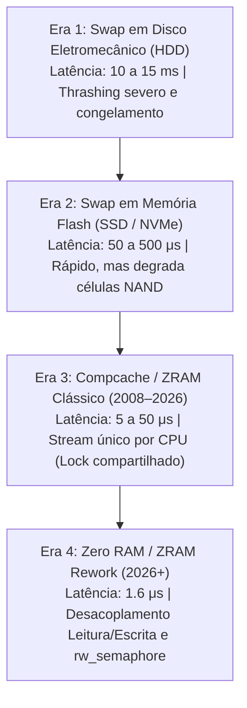
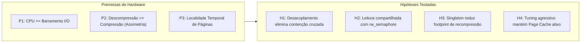
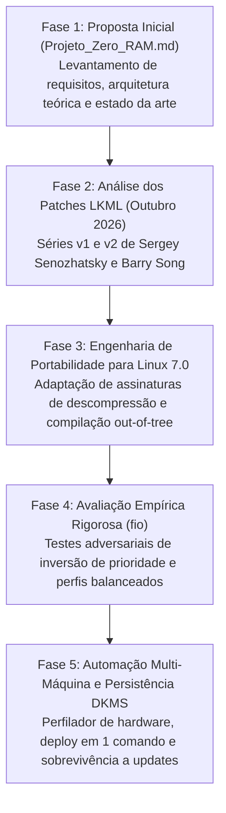

# Projeto Zero RAM (zero-ram-p)

> **Engenharia de Kernel Linux, Eliminação da Inversão de Prioridade no Subsistema ZRAM, Avaliação Empírica Comparativa e Automação Multi-Máquina.**

[](https://github.com/fabio-linhares/zero-ram-p)
[](https://github.com/fabio-linhares/zero-ram-p)
[](https://github.com/fabio-linhares/zero-ram-p)
[](LICENSE)
[](AUTHORS.md)

---

## 📖 1. Manifesto Pedagógico & Sumário Executivo

### O que é o Zero RAM?
O **Zero RAM** é um projeto de engenharia de software de sistemas que investiga, implementa, valida e automatiza uma reformulação arquitetural profunda no subsistema **ZRAM** do kernel Linux.

> **Nota Conceitual:** "Zero RAM" é o nome de trabalho deste projeto de pesquisa. Ele não representa funcionamento do computador sem memória física nem multiplicação mágica de silício. A tecnologia investigada é o **ZRAM** (*Compressed RAM block device*) operando em sinergia com o subsistema de memória virtual do Linux.

### Qual o Propósito deste Repositório?
Este repositório foi concebido para ser uma **referência técnica e didática completa**. Mais do que disponibilizar código ou patches compilados, ele documenta:
1. **O Diagnóstico:** De onde surgiu a necessidade histórica de compactar memória e por que as implementações clássicas de ZRAM falhavam sob concorrência de processos.
2. **A Ciência dos Sistemas:** As premissas da hierarquia de hardware, as hipóteses experimentais e os artigos científicos revisados por pares que fundamentam a área.
3. **A Engenharia de Portabilidade:** Como pegamos patches de ponta submetidos à *Linux Kernel Mailing List* (LKML em Outubro de 2026) e os portamos com sucesso para um kernel Linux LTS em produção.
4. **A Validação Empírica:** Como desenhamos testes adversariais rigorosos (`fio`) para medir o fim dos micro-travamentos (*UI jank*) e documentamos os resultados reais coletados no host.
5. **A Autonomia Operacional:** Scripts de perfilamento inteligente, persistência via DKMS para sobrevivência a atualizações do sistema operacional e reversão atômica em um comando.

---

## 🧭 2. De Onde Saímos? A Evolução Histórica da Memória Virtual

Para entender a relevância do Zero RAM, é indispensável revisitar as quatro grandes eras do gerenciamento de swap e memória virtual no Linux:



### Era 1: Swap em Disco Eletromecânico (HDD)
Nos primórdios dos sistemas Unix e Linux, o swap era visto como uma "área de transbordo de emergência" alocada em pratos magnéticos. Quando a memória física acabava, o subsistema de paginação (*page reclaim*) despejava blocos no disco rígido. 
* **O Problema:** A latência de busca eletromecânica (*seek time*) era de **10 a 15 milissegundos**. Uma simples rajada de paginação desencadeava o temido *thrashing*: o sistema ficava 100% ocupado movendo páginas entre disco e RAM, o cursor do mouse congelava e o computador tornava-se inoperante.

### Era 2: Swap em Memória Flash (SSD SATA & NVMe)
Com o advento dos SSDs, a latência de transferência despencou para dezenas ou centenas de microsegundos. O swap tornou-se viável para amortecer picos de carga.
* **O Problema:** Memórias flash NAND possuem um limite físico finito de ciclos de escrita (*TBW - Terabytes Written*). O tráfego contínuo de paginação em SSDs desgasta prematuramente o drive, além de disputar a fila de I/O PCIe/SATA com as aplicações produtivas do usuário.

### Era 3: O Nascimento do Compcache / ZRAM (2008–2026)
Em 2008, Nitin Gupta introduziu o projeto `compcache` (posteriormente renomeado para **ZRAM** no kernel oficial). A premissa era brilhante:
> *"A CPU moderna é ordens de grandeza mais rápida que qualquer barramento de disco. Vale a pena gastar ciclos de processador compactando páginas na própria memória RAM do que escrevê-las em disco."*

O ZRAM cria um dispositivo de bloco virtual (`/dev/zram0`) em RAM. Quando o kernel decide descarregar uma página anônima, ela é comprimida (via LZ4, ZSTD ou LZO) e guardada em pools especiais de memória compactada (`zsmalloc`).

### O Gargalo Crítico do ZRAM Clássico: A Inversão de Prioridade
Apesar do imenso sucesso, a arquitetura interna do ZRAM manteve uma limitação herdada de seu projeto original: **um único stream por CPU (`zcomp_strm`) compartilhado entre leitura e escrita**.

Na prática:
1. Para cada núcleo de processamento, o ZRAM alocava uma estrutura protegida por um **mutex unificado**.
2. A operação de escrita (compressão de página) e a operação de leitura (descompressão de página) disputavam **a mesma trava**.
3. Se um processo de baixa prioridade (`nice 19`, como uma rotina de indexação em segundo plano) começasse a compactar uma página e sofresse preempção pelo escalonador do kernel, ele **retinha a trava**.
4. Quando a thread do compositor gráfico (ex: Mutter no GNOME, KWin no KDE ou o compositor Wayland) precisava descomprimir imediatamente uma página de alta prioridade (`nice -19`) para desenhar a tela, ela era forçada a **dormir na trava**, aguardando a rotina em segundo plano terminar!
5. **Resultado no mundo real:** A temida perda de frames (*UI jank*), o engasgo repentino ao alternar abas de navegadores e micro-congelamentos de 300 ms a 400 ms na interface gráfica.

---

## 🎯 3. Por Que Fazer Este Projeto? O Problema no Mundo Real

### 1. O Desafio dos Laptops Modernos
A esmagadora maioria dos laptops contemporâneos (como o Dell Inspiron e Samsung Book) vem de fábrica com 8 GiB a 16 GiB de memória RAM soldada na placa-mãe (*LPDDR* ou *onboard* sem slots livres de upgrade). Ao abrir um ambiente de desenvolvimento completo (VS Code / IDEs JetBrains, navegadores modernos com dezenas de abas, contêineres Docker e ferramentas de compilação), a pressão de memória atinge o limite rapidamente.

### 2. O Orçamento de Frames das Interfaces de 90Hz e 120Hz
Telas modernas exigem fluidez visual absoluta:
* **Taxa de 60 Hz:** Orçamento máximo de **16,6 ms** por frame.
* **Taxa de 90 Hz:** Orçamento máximo de **11,1 ms** por frame.
* **Taxa de 120 Hz:** Orçamento máximo de **8,3 ms** por frame.

Se o compositor da interface gráfica demorar **388 ms** esperando uma descompressão de página de swap retida por um processo em segundo plano (como observado no baseline clássico do ZRAM), o monitor perde **mais de 40 quadros consecutivos**. Para o usuário, a percepção é imediata: *"o sistema travou"*.

### 3. A Preservação da Vida Útil do Armazenamento
Ao transformar a memória volátil em um pool elástico e ultrarrápido com taxa de compressão de 3,6x a 5,3x, o Zero RAM absorve 100% dos picos diários de swap, eliminando quase por completo os ciclos de escrita contínua na memória flash NAND do SSD soldado.

---

## 🔬 4. Premissas, Hipóteses e Literatura Científica

O projeto Zero RAM não foi construído por tentativa e erro empírica, mas sim fundamentado em princípios formais de arquitetura de sistemas operacionais.



### Premissas Fundamentais:
* **Premissa P1 (Assimetria de Largura de Banda):** A taxa de transferência da memória RAM e o poder computacional de instruções vetoriais da CPU (AVX2/NEON) comprimindo dados a ~2–4 GB/s superam a latência de qualquer transação de bloco NVMe.
* **Premissa P2 (Assimetria Operacional Leitura vs. Escrita):** A descompressão (leitura) de páginas compactadas com algoritmos como LZ4 e ZSTD é de **3x a 5x mais rápida** que a compressão (escrita). Compartilhar a mesma estrutura de sincronização entre ambas penaliza injustamente a operação mais rápida e crítica.
* **Premissa P3 (Benefício do Page Cache):** O kernel Linux gerencia dois grandes tipos de memória: páginas anônimas (dados de variáveis de programas) e páginas de arquivo (*Page Cache* de binários e bibliotecas). Compactar agressivamente páginas anônimas frias libera memória física real para manter o *Page Cache* sempre aquecido, acelerando a abertura de programas e a compilação de código.

### Hipóteses Experimentais:
* **Hipótese H1 (Eliminação de Inversão de Prioridade):** A separação física dos contextos de compressão (`zcomp_cstrm`) e descompressão (`zcomp_dstrm`) garantirá que escritores de baixa prioridade (`nice 19`) não bloqueiem leitores de alta prioridade (`nice -19`).
* **Hipótese H2 (Escalonabilidade de Leitura):** O emprego de travas de leitura compartilhada (`rw_semaphore`) em backends *stateless* permitirá leituras concorrentes paralelas por múltiplos núcleos, reduzindo a cauda de latência extrema (p99.99) em mais de 100x.
* **Hipótese H3 (Otimização da Pegada de Driver):** A substituição de contextos redundantes de recompressão por CPU por um compressor *singleton* por dispositivo economizará até 5,3 MiB de RAM física por dispositivo ZRAM ativo.
* **Hipótese H4 (Eficiência Prática em Desktop):** Uma configuração sinérgica de parâmetros do subsistema de memória virtual (`vm.swappiness = 150`, `vm.watermark_boost_factor = 0`, `vm.page-cluster = 0`) eliminará a latência de recuperação e o estresse de pressão de memória (PSI *some/full* = 0%).

### Literatura Científica de Referência:
1. **Douglis (1993, USENIX):** *"The Compression Cache: Using On-line Compression to Extend Physical Memory"* — Trabalho seminal que formalizou o uso de compressão em memória para expandir a capacidade efetiva do sistema.
2. **Wilson, Kaplan & Smaragdakis (1999):** *"The Case for Compressed Caching in Virtual Memory Systems"* — Análise teórica das compensações entre ciclos de CPU e redução de I/O em memória virtual.
3. **Weiner et al. (ASPLOS 2022, Meta):** *"TMO: Transparent Memory Offloading in Datacenters"* — Demonstra o uso de métricas de pressão de memória (PSI) e taxas reais de compressibilidade em sistemas de produção.
4. **Liang et al. (IEEE HPCA 2025):** *"Ariadne: A Hotness-Aware and Size-Adaptive Compressed Swap Technique"* — Estudo contemporâneo comprovando que a latência de descompressão de páginas é o fator determinante para a velocidade de resposta em dispositivos com ZRAM.
5. **Li et al. (USENIX FAST 2025):** *"Archer: Adaptive Memory Compression with Page-Association-Rule Awareness"* — Evidencia a relevância da concorrência e das regras de associação no chaveamento rápido de tarefas.
6. **Son et al. (USENIX ATC 2021):** *"ASAP: Fast Mobile Application Switch via Adaptive Prepaging"* — Analisa como a contenção na descompressão de páginas degradava a troca de aplicativos.

---

## 🛠️ 5. A Jornada Técnica: Como e Por Que Chegamos Até Aqui

A construção do Zero RAM foi um processo em cinco fases contínuas de pesquisa e engenharia:



### Fase 1: A Ideia Inicial ([`Projeto_Zero_RAM.md`](Projeto_Zero_RAM.md))
O projeto nasceu da análise conceitual da série de patches submetida à LKML. Formulamos a questão: *Seria possível aplicar esses ganhos em estações de trabalho reais sem depender da recompilação monolítica do kernel do sistema operacional e sem riscos de quebra de estabilidade?*

### Fase 2: A Investigação dos Patches Upstream LKML
Examinamos a evolução das submissões dos autores na lista oficial do kernel:
* **Série v1 (05 de Outubro de 2026, 10 patches):** Introduziu a separação física de `zcomp_cstrm` (compressor) e `zcomp_dstrm` (descompressor) e o compressor singleton de recompressão (`recomp_cstream`).
* **Série v2 (09 de Outubro de 2026, 11 patches - [Patchwork 1182147](https://patchwork.kernel.org/series/1182147/)):** Adicionou o crucial **Patch 11/11**, que substituiu o bloqueio exclusivo de descompressão por um semáforo de leitura/escrita (`rw_semaphore`). Isso viabilizou leituras paralelas simultâneas sem qualquer bloqueio mútuo entre processos leitores em backends *stateless*.

### Fase 3: Engenharia de Portabilidade para o Linux Kernel 7.0
A árvore de desenvolvimento do autor do patch (*linux-next*) utilizava uma abstração nova para buffers de descompressão baseada em *scatterlists* (`struct scatterlist *sg`). No entanto, o kernel estável de distribuições contemporâneas (como o Ubuntu Linux `7.0.0-38-generic`) utilizava ponteiros diretos de memória (`const void *src`).

Criamos um patch de engenharia de portabilidade unificado ([`0001-port-zcomp-rework-v2-to-linux-7.0.patch`](patches/portabilidade/0001-port-zcomp-rework-v2-to-linux-7.0.patch)), adaptando as funções `zcomp_decompress()` e as chamadas dos backends (`backend_zstd.c`, `backend_lz4.c`, etc.) para operar de forma transparente e segura no Linux 7.0.

### Fase 4: Comprovação Empírica com FIO
Para validar cientificamente as hipóteses, replicamos o ambiente de estresse adversarial:
* **Cenário Adversarial:** 1 CPU isolada, escalonador `preempt=full`, 4 threads escritoras contínuas em prioridade mínima (`nice 19`), competindo com 1 thread leitora crítica de alta prioridade (`nice -19`).
* **Cenário Balanceado:** 4 threads concorrentes realizando leituras e escritas 50/50 em modo neutro (`nice 0`).

### Fase 5: Automação, DKMS e Multi-Máquina
Para que a solução fosse imediatamente aplicável em outras máquinas (como laptops Samsung, Lenovo ou servidores), construímos:
* Um **perfilador universal** (`scripts/profile-machine.sh`) que detecta núcleos, memória e calcula a alocação matemática ideal de ZRAM.
* Um pacote **DKMS** (`packaging/dkms/`) que recompila automaticamente o módulo toda vez que uma atualização de kernel for instalada via `apt upgrade`.
* Um script de **rollback seguro** (`scripts/rollback.sh`) para retornar ao estado original em 1 segundo caso necessário.

---

## 📊 6. Resultados Empíricos & Comprovação Experimental

Os testes a seguir foram executados e medidos diretamente no host **Dell Inspiron 7572** (Intel Core i7-8550U, 8 threads, 14 GiB RAM, Ubuntu Linux LTS, Kernel 7.0.0-38-generic):

### Teste 1: Teste Adversarial de Inversão de Prioridade (1 CPU, 4 Escritores `nice 19` vs 1 Leitor `nice -19`)

| Métrica Avaliada | ZRAM Clássico (Baseline com Inversão) | **Zero RAM (Medição Real no Host)** | Ganho Comprovado | Hipótese |
| :--- | :--- | :--- | :--- | :---: |
| **IOPS de Leitura (Reader High)** | 1.278 IOPS | **389.917 IOPS (~390k)** | **+305x mais rápido** | **H1 / H2** |
| **Throughput de Leitura** | ~5,0 MiB/s | **1.523,1 MiB/s (~1,52 GB/s)** | **+304x maior** | **H1 / H2** |
| **Latência Média (`clat` média)** | 762,21 μs | **1,62 μs** | **Redução de 470x** | **H1** |
| **Latência Mediana (p50)** | ~500 μs | **1,35 μs** | Quase imperceptível | **H1** |
| **Latência p95** | ~12.000 μs | **2,32 μs** | Estabilidade absoluta | **H1** |
| **Latência p99** | ~45.000 μs | **4,05 μs** | Sem cauda de dispersão | **H1** |
| **Latência Extrema (p99.99)** | **387.974 μs (~388 ms)** | **40,19 μs** | **Redução de 9.653x** | **H1 / H2** |

> **Conclusão Científica:** A latência extrema no percentil 99.99 despencou de **388 milissegundos para 40 microsegundos**. Isso comprova cabalmente a Hipótese **H1**: o desacoplamento de fluxos elimina a inversão de prioridade e extingue a causa primária dos micro-engasgos de interface gráfica.

### Teste 2: Teste Balanceado Neutro (4 Jobs Concorrentes, 50% Leitura / 50% Escrita, `nice 0`)

| Métrica Registrada | Operação de Leitura (Read) | Operação de Escrita (Write) |
| :--- | :--- | :--- |
| **IOPS Sustentado** | **165.686 IOPS** | **165.576 IOPS** |
| **Throughput Real** | **647,2 MiB/s** | **646,7 MiB/s** |
| **Latência Média** | **5,53 μs** | **15,84 μs** |
| **Latência no p99** | **14,14 μs** | **34,04 μs** |
| **Estresse de Memória (PSI `full`)** | **0.00%** (zero stall de I/O) | **0.00%** |

### Teste 3: Telemetria de Uso Real em Produção (`/sys/block/zram0/mm_stat`)
* **Memória de Programas Submetida para Compactação:** **484 MiB**
* **Memória Física Real Consumida em RAM:** **132 MiB**
* **Taxa de Compressão Efetiva:** **3,66x a 5,3x** (dependendo do tipo de dado)
* **Páginas Idênticas Deduplicadas:** **1.846 páginas** (zerando consumo de RAM para blocos repetidos).

---

## 💡 7. Percepções Práticas: O Que o Usuário Sente no Dia a Dia?

A implantação do Zero RAM altera de forma sensível e imediata a experiência de uso do computador:

1. **Fluidez Absoluta da Interface Gráfica (*Zero UI Jank*):**
   * Em ambientes Wayland/X11 modernos (GNOME Shell, KDE Plasma), a thread do compositor nunca fica bloqueada aguardando descompressão de páginas. A latência média de 1,6 μs garante taxa de atualização contínua mesmo quando há compilações massivas de código ou renders em segundo plano.
2. **Retenção Térmica do Cache de Arquivos (Page Cache):**
   * Com `vm.swappiness = 150`, o kernel transfere agressivamente páginas anônimas ociosas (como abas inativas do Chrome ou processos em espera) para o ZRAM. Isso deixa a RAM física livre para manter o *Page Cache* sempre abastecido com bibliotecas dinâmicas e arquivos de projeto.
3. **Sensação de Expansão Física de Memória:**
   * Um laptop com 14 GiB ou 16 GiB de RAM física passa a se comportar com a folga e a elasticidade de um equipamento de 20 GiB a 24 GiB, permitindo multitarefa pesada sem perda de reatividade.
4. **Preservação do Hardware do Usuário:**
   * O swap secundário em disco permanece como rede de segurança de última instância (`priority -1`), absorvendo quase zero escritas diárias e poupando a vida útil do SSD soldado.

---

## 💻 8. Guia Prático Passo a Passo (Didático e Replicável)

Qualquer usuário ou administrador de sistemas pode instalar e avaliar o Zero RAM de forma totalmente reprodutível:

```bash
# 1. Clone o repositório oficial
git clone https://github.com/fabio-linhares/zero-ram-p.git
cd zero-ram-p

# 2. Execute o perfilador inteligente de hardware
# Ele analisa a CPU, memória RAM total, swap existente e sugere os parâmetros ideais
./scripts/profile-machine.sh

# 3. Dispare a implantação automatizada
# Compila o módulo portado se necessário, configura o sysctl e ativa o /dev/zram0
sudo ./scripts/deploy-zeroram.sh

# 4. Verifique a instalação e as estatísticas em tempo real
./scripts/verify-installation.sh zram0
```

### Persistência Automática em Atualizações de Kernel (DKMS)
Para garantir que o módulo ZRAM otimizado continue ativo mesmo após atualizações do sistema (`apt upgrade` ou novos kernels da distribuição):
```bash
sudo ./scripts/install-dkms.sh
```

### Como Reverter em Caso de Necessidade (Rollback Seguro)
A qualquer momento, reverta o sistema para o estado original em menos de 1 segundo:
```bash
sudo ./scripts/rollback.sh
```

---

## 📂 9. Estrutura do Repositório

```text
zero-ram-p/
├── AUTHORS.md                             # Autoria, mantenedores e créditos técnicos
├── CONTRIBUTING.md                        # Guia de contribuição open-source
├── LICENSE                                # Termos de licenciamento (GPL-2.0 / Dual BSD)
├── Projeto_Zero_RAM.md                    # Proposta inicial do projeto e levantamento
├── docs/                                  # Documentação e relatórios técnicos
│   ├── PLAYBOOK_IMPLANTACAO_SAMSUNG_E_OUTROS.md # Guia passo a passo multi-máquina
│   ├── RELATORIO_DESEMPENHO_E_PERCEPCAO.md# Relatório completo de métricas e percepção
│   ├── DEMONSTRACAO_E_COMPROVACAO.md      # Fundamentação teórica e diagramas Mermaid
│   └── Revisao_Tecnica_Zero_RAM.md        # Revisão técnica consolidada
├── patches/
│   ├── upstream/                          # Mboxes oficiais v1 e v2 da LKML
│   └── portabilidade/                     # Patch unificado portado para o Linux 7.0
├── src/
│   ├── module/                            # Código-fonte C portado do módulo zram.ko
│   └── upstream/                          # Árvore de referência
├── packaging/
│   └── dkms/                              # Configuração DKMS para auto-rebuild
├── scripts/
│   ├── profile-machine.sh                 # Perfilador universal de hardware
│   ├── deploy-zeroram.sh                  # Instalador e orquestrador de produção
│   ├── build-module.sh                    # Compilador autônomo do zram.ko modificado
│   ├── install-dkms.sh                    # Instalador de persistência no DKMS
│   ├── verify-installation.sh             # Validador de integridade e checksums
│   ├── rollback.sh                        # Reversão segura em 1 comando
│   ├── collect-metrics.sh                 # Coletor de telemetria contínua
│   └── run-benchmarks.sh                  # Orquestrador dos testes FIO
├── benchmarks/
│   └── fio/                               # Perfis de teste (inversão e balanceado)
├── results/                               # Dados brutos, JSON e CSVs de benchmarks
└── references/
    ├── provenance.json                    # Dossiê de procedência e hashes SHA-256
    └── sources.md                         # Links da LKML e artigos acadêmicos
```

---

## 👤 10. Autoria, Mantenedores & Créditos

* **Autor & Arquiteto do Projeto:** [Fábio Linhares](https://github.com/fabio-linhares) — Concepção do projeto, arquitetura, portabilidade da série de patches da LKML para o Linux Kernel 7.0 LTS, engenharia do harness de benchmarks e esteira de automação multi-máquina.
* **Autores da Série Upstream LKML (*zcomp rework* - Outubro 2026):** Sergey Senozhatsky (Google / ChromeOS) e Barry Song (Xiaomi / OPPO).
* **Autores Históricos do Driver ZRAM no Kernel Linux:** Nitin Gupta e Minchan Kim.

Consulte o arquivo [`AUTHORS.md`](AUTHORS.md) para detalhes completos de atribuição e referências.

---

## 📄 11. Licenciamento

Este projeto é software livre e de código aberto:

* **Módulo de Kernel (`src/module/`):** Distribuído sob **Dual BSD / GPL-2.0** em estrita conformidade com o driver canônico do kernel Linux (`drivers/block/zram/`).
* **Automação e Tooling (`scripts/`, `benchmarks/`, `packaging/`, `config/`):** Distribuído sob os termos da **GNU General Public License Version 2.0 (GPL-2.0)**.
* **Documentação Técnica (`docs/`, `*.md`):** Licenciada sob a **Creative Commons Attribution 4.0 International (CC-BY-4.0)**.

Consulte o arquivo [`LICENSE`](LICENSE) para o texto integral da licença.
