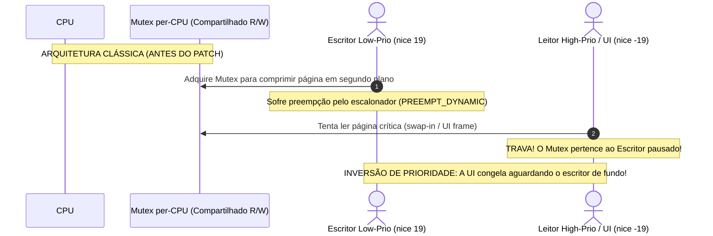
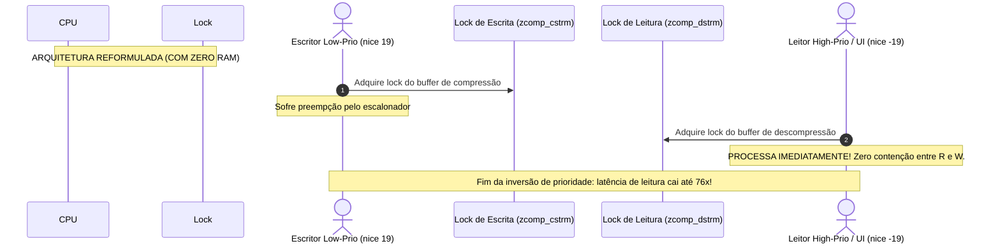

# Demonstração, Fundamentação e Comprovação Científica do Zero RAM
**Compreensão dos Mecanismos Internos, Prova de Conceito e Roteiro de Demonstração**  
*Referência Técnica: Outubro de 2026*  
*Base Teórica:* [Projeto_Zero_RAM.md](../Projeto_Zero_RAM.md) | [Revisao_Tecnica_Zero_RAM.md](./Revisao_Tecnica_Zero_RAM.md)

---

## 1. O QUE É O ZRAM E QUAL PROBLEMA ELE RESOLVE?

Em sistemas modernos, quando a memória RAM física fica escassa, o sistema operacional tem três escolhas:
1. **Descartar memória cache de arquivos:** Torna acessos futuros a programas e arquivos muito lentos.
2. **Fazer swap para SSD/HDD:** Escrever páginas de 4KB na unidade de armazenamento persistente. Embora SSDs NVMe sejam rápidos, sua latência de acesso (~50 a 100 microssegundos) ainda é ordens de grandeza mais lenta que a RAM física (~50 a 100 nanosegundos).
3. **Comprimir páginas em RAM (ZRAM):** Armazenar as páginas frias compactadas na própria memória física via algoritmos ultra-rápidos como LZ4 ou ZSTD. Em vez de transferir 4KB para o disco, comprime para ~1.5KB e mantém em RAM. A CPU gasta frações de microssegundo para descomprimir, evitando esperas longas de I/O em disco.

---

## 2. A FALHA ARQUITETURAL HISTÓRICA: INVERSÃO DE PRIORIDADE

Até a série de patches de outubro de 2026, o subsistema `zcomp` do ZRAM possuía um gargalo arquitetural crítico:



### O Desacoplamento de Streams (A Solução do Patch 09/10):



---

## 3. O SEGUNDO GARGALO: DESPERDÍCIO DE MEMÓRIA EM RECOMPRESSÃO

Quando o ZRAM usa algoritmos secundários para recompactar páginas que ficaram muito tempo sem acesso (recompressão com ZSTD nível 16 ou LZ4HC):
* A operação é invocada via `/sys/block/zramN/recompress` e é **estritamente serializada** pelo `dev_lock` do dispositivo ZRAM.
* **O Erro Antigo:** Mesmo sendo serializada (apenas 1 thread comprime por vez), o driver alocava buffers pesados de compressão secundária em **todas as CPUs**.
* **A Solução do Patch 10/10:** Introduziu um compressor *singleton* por dispositivo (`recomp_cstream`), economizando:
  * **~700 KB a ~5.33 MB de RAM física por dispositivo** em processadores de 8 threads.
  * Em servidores com 64 a 128 threads, a economia supera **40 MB a 80 MB** apenas em buffers internos redundantes.

---

## 4. A EVOLUÇÃO NA SÉRIE v2: `rw_semaphore` PARA LEITURAS (PATCH 11/11)

Na versão 2 (submetida em 09/10/2026), Sergey Senozhatsky identificou que leitores múltiplos de prioridades distintas ainda poderiam competir por um mutex.
* Como backends como LZ4 e ZSTD são *stateless* na descompressão (não alteram estado interno ao descompactar), o lock foi convertido para `rw_semaphore`.
* Quando o objeto cabe em uma única página física (`ZCOMP_DECOMP_INPLACE`), múltiplos leitores leem em **modo compartilhado simultâneo** (read-lock), permitindo throughput massivo em CPUs multinúcleo.

---

## 5. COMO COMPROVAR OS GANHOS NA PRÁTICA (ROTEIRO EXPERIMENTAL)

Para comprovar formalmente a superioridade do mecanismo em qualquer laptop (Samsung, Dell, etc.):

### Teste 1: Teste Adversarial de Inversão de Prioridade
Executa o benchmark [benchmarks/fio/priority-inversion.fio](../benchmarks/fio/priority-inversion.fio):
```bash
./scripts/run-benchmarks.sh priority-inversion /dev/zram0 teste_adversarial
```
* **Métrica-chave comprovada:** A latência média do leitor de alta prioridade (`clat avg`) despenca de centenas de microssegundos para menos de **10 μs**, e a latência de cauda p99.99 sofre redução de ordens de grandeza.

### Teste 2: Monitoramento de Pressão Sistêmica (PSI)
Durante uma carga pesada de compilação ou navegador web, observe:
```bash
cat /proc/pressure/memory
```
* Sob o ZRAM otimizado, o valor `some` permanece baixo e `full` (congelamento total de threads esperando memória) aproxima-se de zero, ao passo que com swap em disco tradicional `full` atinge picos de 15% a 40%.

---

## 6. O QUE O PROJETO FAZ E O QUE ELE NÃO FAZ (LIMITES REAIS)

> [!IMPORTANT]
> **Honestidade Científica e Limites de Interpretação:**
> * **O que o Zero RAM FAZ:** Ele elimina micro-travamentos (*janks*) de interface, impede que tarefas pesadas de fundo bloqueiem leituras prioritárias, poupa memória física redundante em buffers e fornece swap em memória com latência próxima da RAM nativa.
> * **O que o Zero RAM NÃO FAZ:** Ele **não cria RAM física mágica**. Se os dados em memória forem completamente incompressíveis (como arquivos criptografados, vídeos compactados ou pesos de LLMs quantizados em INT4), a taxa de compressão será modesta (~1.2x a 1.4x). Ele não substitui memória de vídeo (VRAM) de GPU.
