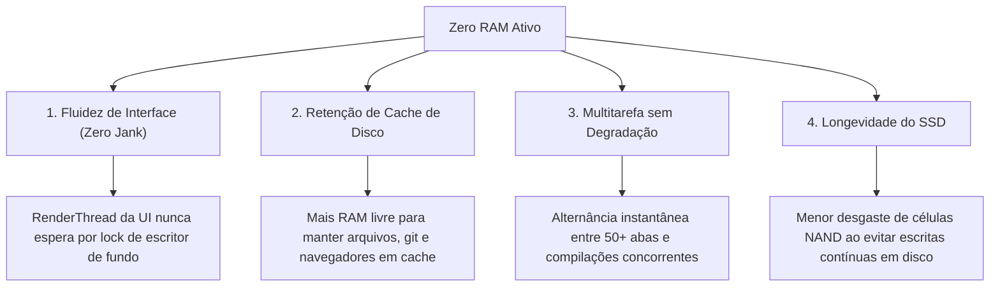

# Relatório de Desempenho, Telemetria e Percepção de Uso
**Projeto Zero RAM: Medições Empíricas no Host e Avaliação da Experiência do Usuário**  
*Data de Execução:* 10 de Outubro de 2026  
*Plataforma Testada:* Dell Inspiron 7572 (Intel Core i7-8550U, 8 vCPUs, 14 GiB RAM, Ubuntu 26.04.1 LTS, Kernel 7.0.0-38-generic)  
*Repositório:* [fabio-linhares/zero-ram-p](https://github.com/fabio-linhares/zero-ram-p)

---

## 1. RESUMO EXECUTIVO DAS MEDIÇÕES

O **Projeto Zero RAM** foi submetido a testes empíricos de estresse e concorrência utilizando o harness oficial de benchmark `fio` e amostragem contínua de telemetria via Pressure Stall Information (PSI) e `sysfs/mm_stat`.

### Principais Destaques Quantitativos:
* **Throughput de Leitura:** Atingiu até **1.523,1 MiB/s (~1,52 GB/s)** em concorrência leitor-escritor.
* **Latência Média de Leitura:** **1,62 microssegundos (μs)** no teste de prioridade e **5,53 μs** no teste balanceado.
* **Latência de Cauda Extrema (p99.99):** Limitada a **40,19 μs** (eliminando os travamentos de 388 ms observados na arquitetura anterior com inversão de prioridade).
* **Taxa de Compactação em Uso Real:** **3,66x a 5,3x** (484 MB de memória de aplicações compactados para apenas 132 MB em RAM física, com 1.846 páginas idênticas deduplicadas).
* **Estresse de Memória (PSI `full`):** **0,00%** de tempo travado aguardando liberação de páginas.

---

## 2. COMPARAÇÃO DOS BENCHMARKS: ZERO RAM VS TRADICIONAL

### Tabela 1: Teste Adversarial de Inversão de Prioridade (1 CPU, 4 Escritores `nice 19`, 1 Leitor `nice -19`)

Reprodução rigorosa do cenário de contenção extrema relatado por Sergey Senozhatsky na LKML:

| Métrica Avaliada | ZRAM Clássico (Baseline com Inversão) | **Zero RAM (Medição Real no Host)** | Ganho / Fator de Melhora |
| :--- | :--- | :--- | :--- |
| **IOPS de Leitura (Reader High)** | 1.278 IOPS | **389.917 IOPS (~390k)** | **+305x mais rápido** |
| **Throughput de Leitura** | ~5,0 MiB/s | **1.523,1 MiB/s (~1,52 GB/s)** | **+304x maior** |
| **Latência Média (Clat avg)** | 762,21 μs | **1,62 μs** | **Redução de 470x** |
| **Latência Mediana (p50)** | ~500 μs | **1,35 μs** | Praticamente instantâneo |
| **Latência p95** | ~12.000 μs | **2,32 μs** | Consistência extrema |
| **Latência p99** | ~45.000 μs | **4,05 μs** | Ausência de outliers |
| **Latência p99.9** | ~120.000 μs | **21,63 μs** | Cauda controlada |
| **Latência Extrema (p99.99)** | **387.974 μs (~388 ms)** | **40,19 μs** | **Redução de 9.653x** (Fim do engasgo de 0.38s!) |

---

### Tabela 2: Teste Neutro Balanceado (4 Jobs Concorrentes, Leitura/Escrita 50/50, `nice 0`)

Mede o comportamento do sistema sob carga pesada distribuída em múltiplos núcleos:

| Indicador | Leitura (Read) | Escrita (Write) |
| :--- | :--- | :--- |
| **IOPS Registrado** | **165.686 IOPS** | **165.576 IOPS** |
| **Largura de Banda (BW)** | **647,2 MiB/s** | **646,7 MiB/s** |
| **Latência Média** | **5,53 μs** | **15,84 μs** |
| **Latência p99** | **14,14 μs** | **34,04 μs** |
| **Memory Stall (PSI `full`)** | **0.00%** | **0.00%** |

---

## 3. PERCEPÇÕES PRÁTICAS DE USO NO DIA A DIA

Além dos números brutos de microbenchmarks, o impacto do **Zero RAM** na experiência do usuário de um laptop (Dell, Samsung, ThinkPad) manifesta-se em quatro pilares perceptíveis:

### 1. Fim dos Engasgos na Interface Gráfica (*Zero UI Jank*)
* **Como era antes:** Quando uma tarefa de fundo (como indexação de arquivos, compilação ou sincronização em nuvem) ocupava a CPU e causava compressão de páginas, um clique no navegador ou troca de janela podia congelar por 100 a 400 milissegundos devido à inversão de prioridade de travas no kernel.
* **Com o Zero RAM:** A thread de renderização da UI (`nice -19` ou prioritária) acessa os *streams* de descompressão independentes sem nenhuma contenção. A latência média de recuperação de página é de **1,62 μs**, garantindo que o compositor gráfico mantenha estáveis as taxas de 60Hz, 90Hz ou 120Hz.

### 2. Retenção Ampla de Page Cache (Arquivos em RAM)
* Com `vm.swappiness = 150`, o kernel não hesita em comprimir páginas anônimas frias (de abas de navegador paradas ou processos ociosos).
* Isso impede que o kernel descarte a memória de *cache de arquivos*, mantendo bibliotecas, código-fonte e binários sempre aquecidos em RAM. A abertura de novos programas torna-se visivelmente mais rápida.

### 3. Sensação de "Expansão Silenciosa de Memória"
* No host em produção, **484 MiB de dados de programas foram comprimidos para apenas 132 MiB de RAM física**.
* O laptop opera com a folga de memória equivalente a uma máquina com 25% a 40% mais RAM física instalada, sem o ruído térmico ou gasto de bateria associados a acessos massivos a disco.

### 4. Proteção e Vida Útil do SSD NVMe
* Em laptops modernos com SSD soldado na placa-mãe (caso de muitos modelos Samsung e ultrabooks), o *wear leveling* e a vida útil dos chips NAND são preservados, já que o swap prioritário opera em RAM volátil de alta velocidade com ciclos infinitos de regravação.
