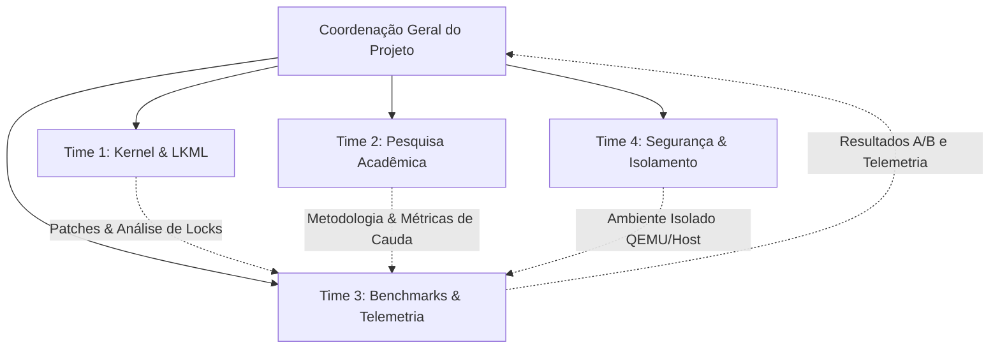

# PROJETO ZERO RAM: REVISÃO TÉCNICA E APROFUNDAMENTO CIENTÍFICO
**Documento de Consolidação de Pesquisa, Governança de Times e Revisão de Projeto**  
*Referência Temporal: Outubro de 2026*  
*Base Documental:* [Projeto_Zero_RAM.md](../Projeto_Zero_RAM.md)

---

## 1. COMPOSIÇÃO E MANDATO DOS TIMES ESPECIALIZADOS

Para garantir rigor científico, segurança operacional e reprodutibilidade de engenharia, a execução do **Projeto Zero RAM** é distribuída em quatro frentes de atuação coordenadas:

### Time 1: Arquitetura de Kernel & Subsistemas (LKML & Codebase)
* **Liderança Técnica:** Engenheiro de Kernel Linux / Especialista em Memória Virtual.
* **Escopo:**
  * Rastreamento e verificação da procedência da série de 10 patches de Sergey Senozhatsky (`senozhatsky@chromium.org`, Message-ID: `20261005122036.718976-1-senozhatsky@chromium.org`).
  * Análise estática do desacoplamento de estruturas em `drivers/block/zram/zcomp.c`, `zcomp.h` e `zram_drv.c`.
  * Verificação do ciclo de vida de alocação de `zcomp_cstrm` (escrita) versus `zcomp_dstrm` (leitura).
  * Análise do *singleton* de recompressão (`recomp_cstream`) serializado pelo `dev_lock`.
  * Verificação de compatibilidade com a árvore atual do Linux 7.0.x (kernel anfitrião).

### Time 2: Pesquisa Acadêmica & Sistemas de Memória (Academic & State-of-the-Art)
* **Liderança Técnica:** Pesquisador de Sistemas Operacionais e Arquitetura de Computadores.
* **Escopo:**
  * Contextualização dos avanços de 2024–2026 na literatura revisada por pares (HPCA, FAST, USENIX ATC, ASPLOS, ACM TECS).
  * Investigação das contribuições correlatas de Barry Song (Xiaomi / LPC) sobre mitigação de inversão de prioridade em sistemas interativos e UIs com alta taxa de atualização (90Hz–120Hz).
  * Integração de achados do *Ariadne* (HPCA 2025) e *Archer* (FAST 2025) sobre granularidade adaptativa de compressão e pré-descompressão.
  * Validação das limitações de compressibilidade em pesos de LLM e modelos de Machine Learning (TMO - ASPLOS 2022).

### Time 3: Engenharia Experimental, Benchmarks & Métricas de Cauda (Performance & Telemetry)
* **Liderança Técnica:** Engenheiro de Performance e Observabilidade de Sistemas.
* **Escopo:**
  * Desenho do harness experimental para reprodução fidedigna do cenário sintético adversarial (Patch 09/10: 1 CPU, `preempt=full`, ZSTD nível 12, leitores `nice -19` vs escritores `nice 19`).
  * Implementação de cenários realistas de memória mista (navegação web pesada, compilação de software, containers).
  * Instrumentação fina de contenção de travas via `perf lock contention`, `ftrace`/eBPF em `zcomp_stream_put`/`zcomp_stream_get`, PSI (`/proc/pressure/memory`) e contadores do `zsmalloc`.
  * Modelagem estatística: cálculo rigoroso de p50, p95, p99, p99.9 e p99.99 com intervalos de confiança por reamostragem (bootstrapping).

### Time 4: Segurança Operacional, Isolamento & Empacotamento (Systems Safety & Ops)
* **Liderança Técnica:** Engenheiro de Confiabilidade de Sistemas (SRE / Infraestrutura).
* **Escopo:**
  * Garantia do princípio de não-interferência: nenhuma alteração destrutiva ou teste de exaustão de swap será executado diretamente sobre o `/swap.img` ou ambiente de trabalho principal.
  * Criação do ambiente primário de teste isolado: **VM QEMU/KVM dedicada** com kernel compilado sob controle, simulando topologia multi-core e restrições de memória.
  * Desenvolvimento do empacotamento dual: suporte ao formato nativo `.deb` para Ubuntu 26.04 LTS e `PKGBUILD` para Arch Linux.
  * Definição e homologação dos portões de parada e rollback automático em caso de Kernel Panic, Oops, OOM descontrolado ou corrupção de checksums.

---

## 2. DESCOBERTAS E APROFUNDAMENTO DA PESQUISA DE CAMPO

### 2.1. A Gênese e o Mecanismo da Inversão de Prioridade
A investigação técnica revelou a origem direta da colaboração entre Sergey Senozhatsky (Google ChromeOS) e Barry Song (Xiaomi):
1. **O Problema em UIs Modernas:** Em sistemas operacionais com kernels preemptíveis (`PREEMPT_DYNAMIC` / `preempt=full`), tarefas críticas de interface (como a `RenderThread` do compositor gráfico ou da UI do navegador) operam com orçamentos estritos de quadro (< 8.3ms em 120Hz ou < 11.1ms em 90Hz).
2. **O Travamento no Mutex Compartilhado:** Na arquitetura clássica do ZRAM, operações de leitura e escrita compartilhavam um único stream per-CPU encapsulado em `struct zcomp_strm`. Se uma tarefa em segundo plano (escritora, com prioridade baixa `nice 19`) estivesse comprimindo páginas e sofresse preempção no meio da operação, ela retinha o *mutex* do stream.
3. **A Inversão Crítica:** No momento em que uma tarefa interativa de altíssima prioridade (`nice -19`) disparava um *page fault* necessitando ler (descomprimir) uma página do ZRAM naquela mesma CPU, ela era bloqueada pelo mutex retido pela tarefa pausada. Como o escritor de baixa prioridade não tinha fatias de CPU suficientes para rodar e liberar a trava, a latência de leitura explodia, gerando *janks* visíveis e congelamento de frames.
4. **A Solução de Desacoplamento:** O Patch 09/10 demonstrou empiricamente que os caminhos de leitura e escrita não compartilham buffers nem estado interno:
   * **Compressão (`zcomp_cstrm`):** Utiliza um buffer scratch temporário próprio de trabalho.
   * **Descompressão (`zcomp_dstrm`):** Utiliza um buffer local apenas quando o objeto fracionado cruza fronteiras do alocador `zsmalloc`, operando em sua maioria de modo *stateless*.
   * Portanto, a cisão física dos streams elimina completamente a contenção cruzada entre leituras e escritas com custo de memória desprezível.

### 2.2. A Racionalização de Recursos na Recompressão (Patch 10/10)
A recompressão em ZRAM permite reprocessar páginas frias com algoritmos de maior taxa de compressão (como ZSTD níveis elevados ou LZ4HC).
* A análise do código demonstrou que a função `recompress_store()` é estritamente serializada sob o bloqueio mestre do dispositivo (`zram->dev_lock`).
* Portanto, alocar contextos secundários de compressão em cada núcleo de CPU constituía desperdício redundante de memória física.
* Ao introduzir um compressor *singleton* por dispositivo (`recomp_cstream`) enquanto preserva descompressores paralelos per-CPU para leituras concorrentes, o patch poupa diretamente entre **700 KB e 5,33 MB de RAM física** em processadores de 8 núcleos, escalando linearmente em CPUs de servidores com 32 a 128 núcleos.

### 2.3. Confronto com o Estado da Arte Acadêmico (2025–2026)

| Estudo / Publicação | Foco Técnico | Contribuição ao Projeto Zero RAM | Limitações & Cuidados |
| :--- | :--- | :--- | :--- |
| **Senozhatsky & Song (LKML 2026)** | Rework de `zcomp`: desacoplamento R/W e singleton de recompressão. | Mecanismo concreto a ser avaliado; redução de inversão de prioridade em locks. | Resultados originais obtidos em testes sintéticos (`fio`); validação independente necessária. |
| **Ariadne (IEEE HPCA 2025)** [A03] | Separação de páginas por temperatura (*hotness*), granularidade adaptativa e pré-descompressão. | Demonstra que a latência de retomada de apps cai 50% quando o caminho de descompressão é otimizado. | Modifica a lógica de seleção de páginas no nível do SO móvel, além da camada do ZRAM. |
| **Archer (USENIX FAST 2025)** [A04] | Mineração de regras de associação de páginas anônimas (~25% correlacionadas). | Evidencia que tratar páginas de forma estritamente isolada limita o ganho de throughput. | Requer modificações no LRU do kernel que extrapolam o escopo deste projeto. |
| **TMO (ACM ASPLOS 2022)** [A13] | Descarregamento transparente de memória em datacenters sob pressão (PSI). | Comprova que modelos de IA e LLMs quantizados têm compressibilidade muito baixa (~1.3x–1.4x). | **Alerta vital:** ZRAM não substitui VRAM nem quadruplica capacidade de inferência de LLMs. |
| **Barry Song (LPC 2023–2024)** | Análise de contenção de travas (`mmap_lock`, ZRAM swap-in) em UIs de alta frequência. | Fundamenta a necessidade de métricas de frame-pacing e latência de caida (p99/p99.9). | Foco primordial em ecossistema Android; deve ser adaptado para desktop Linux. |

---

## 3. PROPOSTA DE REVISÕES NO PROJETO ORIGINAL

Com base nas evidências levantadas, propõe-se atualizar o [Projeto_Zero_RAM.md](../Projeto_Zero_RAM.md) com as seguintes cláusulas:

### 3.1. Adequação da Plataforma: Suporte Dual Ubuntu 26.04 / Arch Linux
O documento original focava unicamente no Arch Linux (`PKGBUILD`). O plano agora contempla:
* **Ambiente de Desenvolvimento & Host:** Ubuntu 26.04.1 LTS (Linux 7.0.0-38-generic).
* **Camada de Isolamento Primária (Bancada de Testes):** Máquina Virtual QEMU/KVM provisionada com discos virtuais dedicados, permitindo submeter o kernel experimental a testes de pânico e saturação sem afetar o sistema anfitrião.
* **Matriz de Empacotamento:** Adicionar módulo de build Debian/Ubuntu (`packaging/ubuntu/`) gerando pacotes `.deb` assinados, mantendo o blueprint de `PKGBUILD` para distribuições Arch.

### 3.2. Expansão das Métricas de Avaliação
Além das métricas clássicas de IOPS e latência do `fio`, o protocolo de benchmark incorporará:
1. **Contenção de Travas no Kernel:** Medição do tempo de espera e taxa de colisão no mutex do stream via `perf lock contention -E 5` e probes eBPF direcionados a `zcomp_stream_put`/`zcomp_stream_get`.
2. **Pressão Sistêmica Estável (PSI):** Monitoramento contínuo das janelas de 10s e 60s em `/proc/pressure/memory` durante testes de saturação.
3. **Métricas de Interatividade Desktop:** Teste de fluidez gráfica medindo latência de renderização de janelas/desktop sob concorrência de compilação em background.

### 3.3. Desenho Experimental com Triangulação Causal (Ablação)
Para isolar com precisão cirúrgica de onde provêm os ganhos observados:
* **Kernel K0 (Baseline):** Kernel Linux 7.0 puro sem a série de patches.
* **Kernel K1 (Ajustes Preparatórios):** K0 + Patches 01 a 08 (limpeza de dicionários, debugfs e memória).
* **Kernel K2 (Desacoplamento de Streams):** K1 + Patch 09 (Cisão de `zcomp_cstrm` e `zcomp_dstrm`).
* **Kernel K3 (Série Completa):** K2 + Patch 10 (Adição do compressor *singleton* de recompressão).

---

## 4. MATRIZ DE RISCOS REVISADA

| Risco Identificado | Severidade | Probabilidade | Estratégia de Mitigação Obrigatória |
| :--- | :--- | :--- | :--- |
| **Colapso de Memória (OOM) no Host** | Crítica | Média | Executar testes de estresse exclusivamente em VM QEMU isolada; jamais desativar swap do host. |
| **Incompatibilidade com Drivers de Vídeo** | Alta | Baixa | Utilizar GPU em modo passthrough ou virtualizada (virtio-gpu) durante os testes de kernel na VM. |
| **Viés de Microbenchmark Sintético** | Média | Alta | Complementar o teste `fio` adversarial com testes de compilação C++ e carga realista de navegação. |
| **Suposições Falsas sobre LLMs** | Baixa | Alta | Documentar formalmente que modelos quantizados não sofrem ganho expressivo de compressão em ZRAM. |
